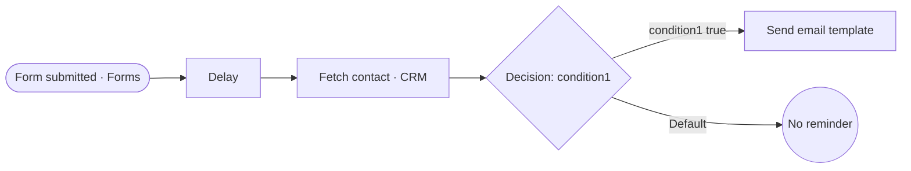

# Kickoff Booking Reminder

> A form submission waits, looks up the contact, and sends the right reminder for that case, so clients don't miss kickoffs.

**Live case study:** [https://mnkiswan.github.io/kickoff-booking-reminder/](https://mnkiswan.github.io/kickoff-booking-reminder/) · **Portfolio:** [zoho-flow-portfolio](https://mnkiswan.github.io/zoho-flow-portfolio/)

**Trigger:** A kickoff form entry is submitted  
**Zoho apps:** Zoho Forms, Zoho CRM, Zoho Flow delay, Email template

## Flow

## Steps

1. **Form is submitted** (Zoho Forms): A client submits the kickoff form.
2. **Wait** (Delay): The flow pauses before the next action, so the reminder lands at the right time.
3. **Fetch the contact** (Zoho CRM): The contact record is loaded so the decision can use it.
4. **Decide which reminder applies** (Decision): condition1 is checked. If it matches, the reminder goes out. If nothing matches, the Default branch runs and nothing is sent.
5. **Send the reminder email** (Email template): The matched branch sends the reminder template.

## The problem

Without a reminder, kickoffs were missed or pushed back, which slowed onboarding for everyone.

## Business impact

- **Missed kickoffs**: Clients get the reminder without anyone remembering to send it.
- **Message per case**: The decision step sends the reminder that fits the contact.
- **Chasing clients**: Staff stop sending confirmations by hand.

---
Part of the [Zoho Flow portfolio](https://github.com/mnkiswan/zoho-flow-portfolio).
